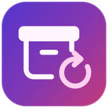
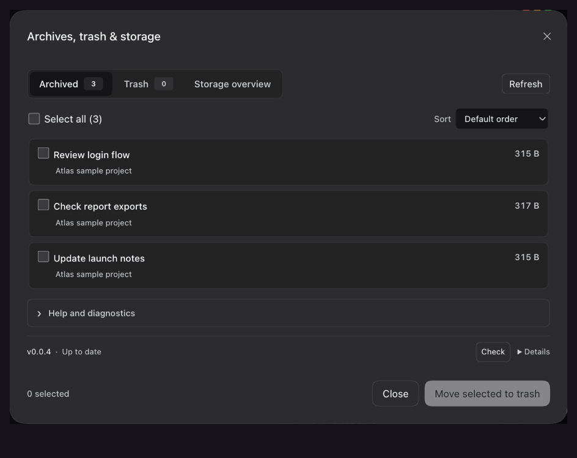

<p align="center">
  
</p>

<h1 align="center">dsh-archive-delete</h1>

<p align="center">A trash bin and storage overview for DeepSeek Harness.</p>

<div align="center">

[Install](#install) · [Screenshots](#preview) · [Latest release](https://github.com/QwQBiG/dsh-archive-delete/releases/latest) · [简体中文](README.zh-CN.md)

</div>

<p align="center">
  <picture>
    <source media="(prefers-reduced-motion: reduce)" srcset="https://raw.githubusercontent.com/QwQBiG/dsh-archive-delete/main/assets/screenshots/en-archives.png?view=desktop">
    
  </picture>
</p>

<p align="center">Recorded in DSH Desktop with sample data.</p>

## Install

**v0.0.6** supports **DSH Desktop 0.2.1-rc.3, 0.2.1-rc.5 and 0.2.2-rc.3** on macOS and Windows with JSONL storage. Open **Plugins → Add plugin** in DSH Desktop and paste the prebuilt package URL below.

```text
https://github.com/QwQBiG/dsh-archive-delete/releases/download/v0.0.6/qwqbig-dsh-archive-delete-0.0.6.tgz
```

Already installed? Open the plugin details and choose **Review update → Confirm upgrade**. If DSH asks you to restart, quit the app fully and reopen it. Use the install URL above if your version has no update button. [Installation and troubleshooting](docs/installation.md)

If a Desktop update marks the plugin incompatible or the manager cannot find its bundled pnpm, see [After upgrading DSH Desktop](docs/installation.md#after-upgrading-dsh-desktop).

## What you can do

| Task | Where to start |
| --- | --- |
| **Clear archived conversations in batches** | Choose **Move to trash** from an archived conversation’s menu, or select several in **Manage archives, trash and storage**. Use the size sort to find larger conversations. Dedicated subagents move with their conversation. |
| **Restore or permanently delete** | Open **Trash** to restore a conversation to its original workspace or confirm permanent deletion. Expand **Recent permanent deletions** to see completed deletions. |
| **See what takes up space** | Open **Storage overview** and scan DSH or a workspace. Inspect file types, large files and top-level folders. Scans are read-only. |

Trash stays until you restore or delete it, including after uninstalling the plugin. For a move that is waiting on DSH, choose **Cancel waiting and review** in **Archived** to try again. [How trash and restore work](docs/operations.md)

## Preview

<details>
<summary>View screenshots</summary>

**Archived conversations**


**Trash**


**Workspace storage**


</details>

## Project links

[Changelog](CHANGELOG.md) · [Contributing](CONTRIBUTING.md) · [Architecture](docs/architecture.md) · [Verification](docs/acceptance.md) · [Apache-2.0](LICENSE)
