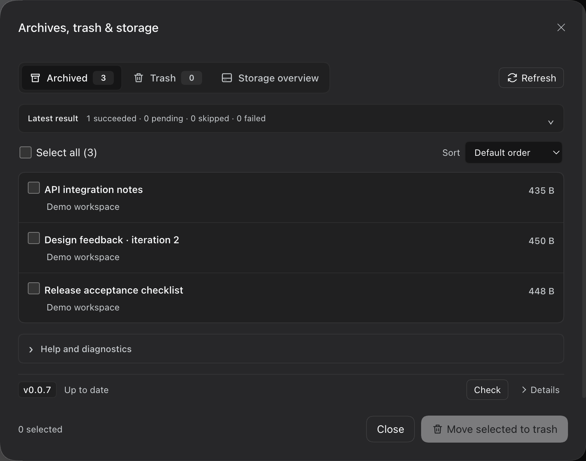
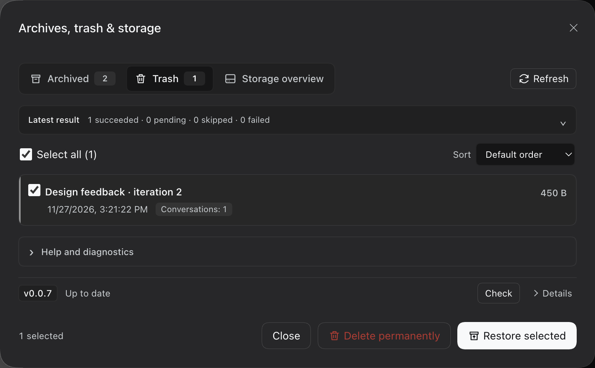
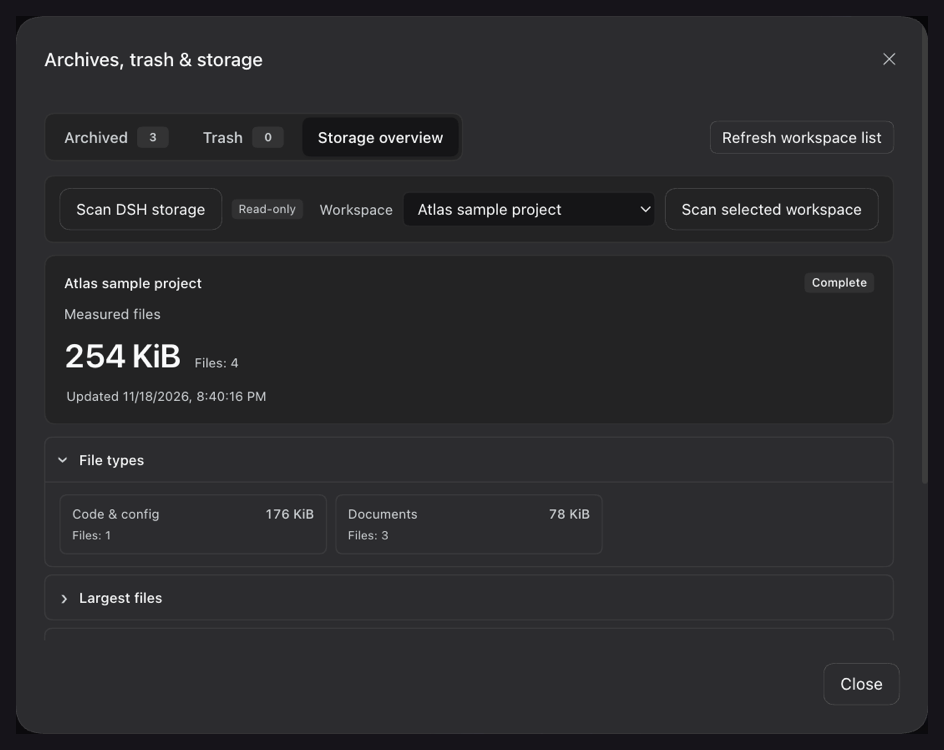

# dsh-archive-delete

[简体中文](README.zh-CN.md) · English

Manage archived conversations in DeepSeek Harness, with recoverable trash and a storage overview for DSH and your workspaces.

`@qwqbig/dsh-archive-delete` · **v0.0.4** · macOS / Windows · DSH Desktop **0.2.1-rc.3 / 0.2.1-rc.5**, JSONL storage · [Apache-2.0](LICENSE)

## Install

Open **Plugins → Add plugin** in DSH Desktop and paste:

```text
https://github.com/QwQBiG/dsh-archive-delete/releases/download/v0.0.4/qwqbig-dsh-archive-delete-0.0.4.tgz
```

The package is ready to install, with no build step. See the [installation guide](docs/installation.md) for setup and troubleshooting.

## Features

- Move archived conversations and their dedicated subagents to trash, including idle conversations held by DSH.
- Restore conversations to their original workspace, or confirm permanent deletion of selected trash entries.
- Select conversations in batches, sort by size and review or retry individual results.
- See storage use by category, file type, large file and folder for DSH or a selected workspace.
- Check GitHub for updates and choose when to install them.

## Preview

Archived conversations, trash and storage overview with sample data.


<details>
<summary>Screenshots</summary>

**Batch archive cleanup**



**Restore or clear selected trash**



**File types and large files**



</details>

## Use

1. Archive a conversation in DSH, then choose **Move to trash** from its menu. To handle several conversations, open **Manage archives, trash and storage** in the plugin details.
2. Review the conversations and confirm the move. Open **Trash** to restore them or delete them permanently. Trash stays until you clear it, including after uninstalling the plugin.
3. Open **Storage overview** and scan DSH or a workspace to see which categories and file types use the most space. When you scan the same location again, the previous result stays visible until the new one is ready.

If a move is pending, find it in **Archived** and choose **Cancel waiting and review** to try again. Permanent deletion removes the selected logs and recovery records and cannot be undone.

## Updates

If you use **v0.0.1**, paste the installation URL above into **Add plugin** to upgrade to v0.0.4.

The plugin checks GitHub daily and shows updates in the version row. Choose **Review update**, then **Confirm upgrade**. If prompted, fully quit and reopen DSH to load the installed version. You can also upgrade by adding the new Release URL through the plugin manager.

## Development

Use Node 24+ and the pinned pnpm version. Check the Node version in your terminal before running the suite. See [Contributing](CONTRIBUTING.md) for the Node executable shipped with DSH Desktop.

```sh
node --version
pnpm install --frozen-lockfile
pnpm verify
pnpm pack --pack-destination artifacts
node scripts/release-artifacts.mjs artifacts
node --import tsx scripts/check-update-package.mjs artifacts
```

[Contributing](CONTRIBUTING.md) · [Architecture](docs/architecture.md) · [Operation recovery](docs/operations.md) · [Verification](docs/acceptance.md) · [Changelog](CHANGELOG.md)
