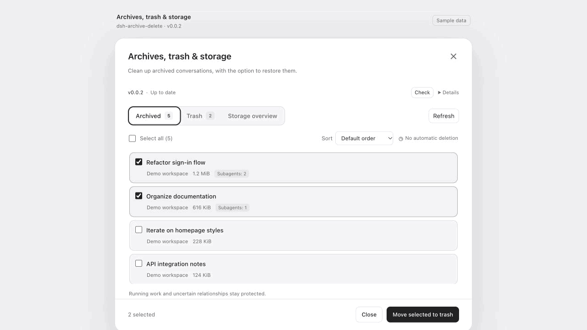
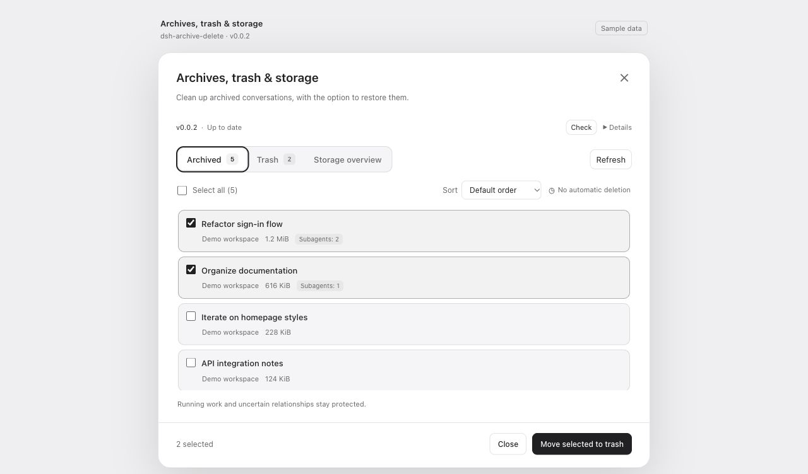
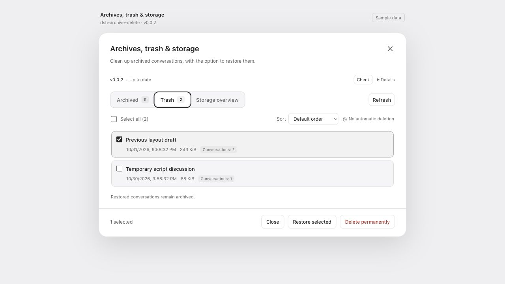
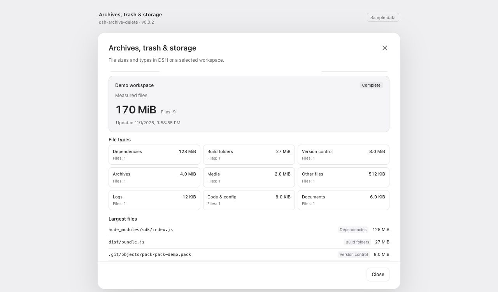

# dsh-archive-delete

[简体中文](README.zh-CN.md) · English

Batch archive cleanup, recoverable trash, and file and folder usage inside DeepSeek Harness.

`@qwqbig/dsh-archive-delete` · **v0.0.3** · macOS / Windows · DSH Desktop **0.2.1-rc.3 / 0.2.1-rc.5**, JSONL storage · [Apache-2.0](LICENSE)

## Install

Open **Plugins → Add plugin** in DSH Desktop and paste:

```text
https://github.com/QwQBiG/dsh-archive-delete/releases/download/v0.0.3/qwqbig-dsh-archive-delete-0.0.3.tgz
```

The package includes compiled files and is ready to install. [Installation guide](docs/installation.md)

## Features

- Move archived conversations and their dedicated subagents to trash. Idle sessions can be processed immediately.
- Restore conversations to their original workspace, or permanently delete selected trash after confirmation.
- Batch selection, largest-first sorting, per-item results and retries.
- Storage categories, file types, large files and folder sizes for DSH and a selected workspace.
- In-app GitHub update checks and confirmed upgrades.

## Preview

Archived conversations, trash and storage overview with sample data.



<details>
<summary>Screenshots</summary>

**Batch archive cleanup**



**Restore or clear selected trash**



**File types and large files**



</details>

## Use

1. Archive a conversation in DSH, then choose **Move to trash** from its menu. Open **Manage archives, trash and storage** in plugin details for batches.
2. Review the targets and confirm. **Trash** contains restore and permanent-delete actions. Trash stays until you remove it; uninstalling preserves it.
3. Open **Storage overview** and start a DSH or workspace scan. Categories and file types show where the measured bytes are. Rescanning the same scope keeps the previous result visible until the new one arrives.

A pending move stays in **Archived**. **Cancel waiting and review** opens a new confirmation to try again. Permanent deletion removes the selected trash logs and recovery records and cannot be undone.

## Updates

For **v0.0.1**, paste the installation URL above into **Add plugin** once to upgrade to v0.0.3.

The version row checks GitHub daily. Choose **Review update**, then **Confirm upgrade**. When prompted, fully quit DSH and reopen it to load the installed version. You can also add a newer Release URL through the same plugin manager.

## Development

Use Node 24+ and the pinned pnpm version:

```sh
pnpm install --frozen-lockfile
pnpm verify
pnpm pack --pack-destination artifacts
node scripts/release-artifacts.mjs artifacts
node --import tsx scripts/check-update-package.mjs artifacts
```

[Contributing](CONTRIBUTING.md) · [Architecture](docs/architecture.md) · [Operation recovery](docs/operations.md) · [Verification](docs/acceptance.md) · [Changelog](CHANGELOG.md)
