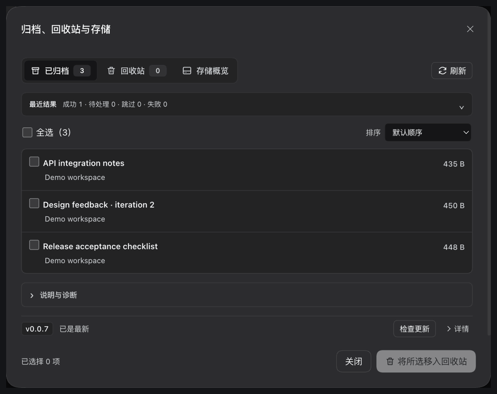
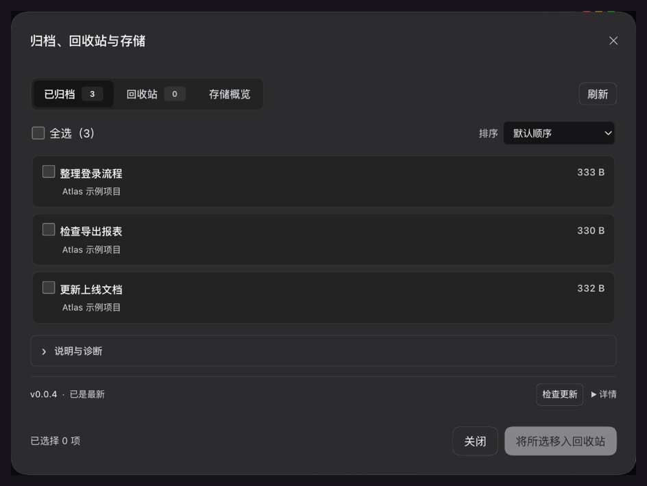
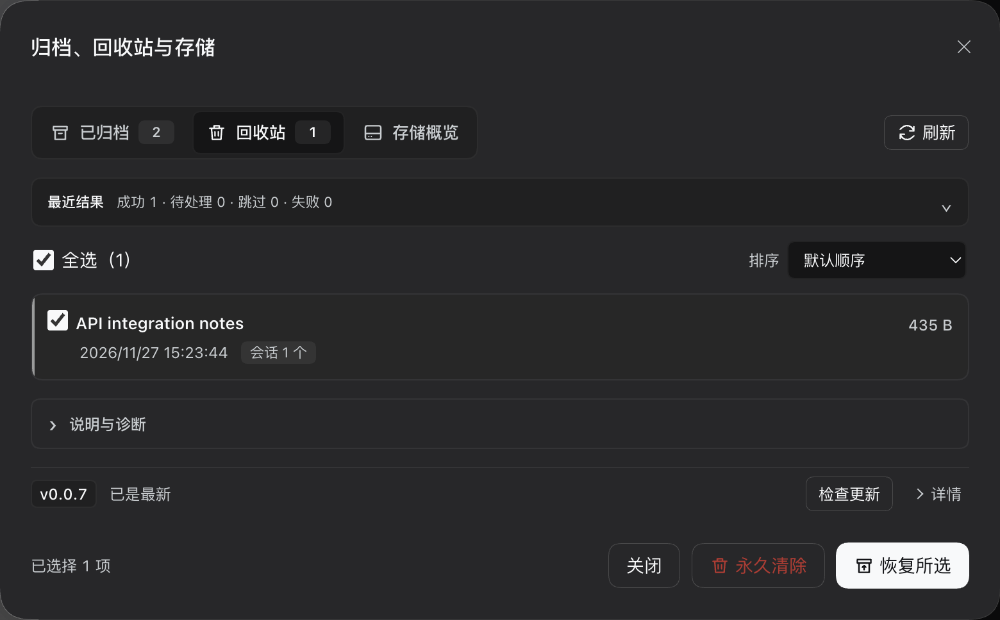
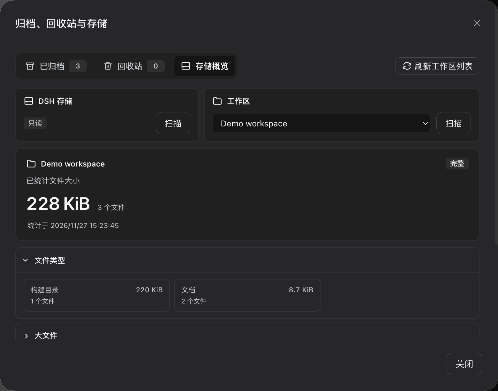

# dsh-archive-delete

简体中文 · [English](README.md)

在 DeepSeek Harness 中管理已归档会话：移入回收站、恢复或永久清除，也能查看 DSH 和工作区的存储占用。

`@qwqbig/dsh-archive-delete` · **v0.0.4** · macOS / Windows · DSH Desktop **0.2.1-rc.3 / 0.2.1-rc.5**、JSONL 存储 · [Apache-2.0](LICENSE)

## 安装

打开 DSH 桌面端的 **插件 → 添加插件**，粘贴：

```text
https://github.com/QwQBiG/dsh-archive-delete/releases/download/v0.0.4/qwqbig-dsh-archive-delete-0.0.4.tgz
```

安装包可直接使用，无需构建。安装和排错步骤见[安装指南](docs/installation.zh-CN.md)。

## 功能

- 将归档会话和专属子代理移入回收站，支持处理 DSH 持有的闲置会话。
- 将会话恢复到原工作区，或确认后永久清除所选回收站记录。
- 批量选择、按大小排序，查看每项结果并单独重试。
- 按分类、文件类型、大文件和目录查看 DSH 或所选工作区的存储占用。
- 在插件内检查 GitHub 更新，自行决定何时升级。

## 界面预览

使用示例数据展示归档会话、回收站和存储概览。



<details>
<summary>查看截图</summary>

**批量清理归档**



**恢复或清除所选回收站记录**



**文件类型与大文件**



</details>

## 使用

1. 在 DSH 中归档会话，再从菜单选择 **移入回收站**。需要批量处理时，打开插件详情中的 **管理归档、回收站与存储**。
2. 核对会话后确认移动。在 **回收站** 中可使用 **恢复所选** 找回会话，也可以选择 **永久清除** 后确认。展开 **最近永久删除** 可查看删除历史。
3. 打开 **存储概览**，扫描 DSH 或工作区。结果先显示已测得的总量，展开后可查看文件类型、大文件和一级目录。再次扫描同一位置时，上次结果会保留到新结果返回。

移动仍在等待时，可在 **已归档** 中选择 **取消等待并重新核对** 再次尝试。回收站内容会保留到你主动清除，卸载插件后也会保留。永久清除会移除所选日志和恢复记录，无法撤销。

## 更新

如果你还在使用 **v0.0.1**，请在 **添加插件** 中粘贴上方安装 URL，升级到 v0.0.4。

插件每天检查 GitHub，并在版本栏显示更新。选择 **查看并升级**，再 **确认升级**。提示重启时，完全退出 DSH 后重新打开，即可加载已安装版本。也可以在插件管理器中添加新版 Release URL 来升级。

## 开发

使用 Node 24+ 和仓库固定的 pnpm 版本。运行测试前先确认终端里的 Node 版本。DSH Desktop 随附的 Node 路径可见[贡献指南](CONTRIBUTING.zh-CN.md)。

```sh
node --version
pnpm install --frozen-lockfile
pnpm verify
pnpm pack --pack-destination artifacts
node scripts/release-artifacts.mjs artifacts
node --import tsx scripts/check-update-package.mjs artifacts
```

[参与贡献](CONTRIBUTING.zh-CN.md) · [架构](docs/architecture.zh-CN.md) · [操作恢复](docs/operations.zh-CN.md) · [验证记录](docs/acceptance.zh-CN.md) · [更新日志](CHANGELOG.zh-CN.md)
