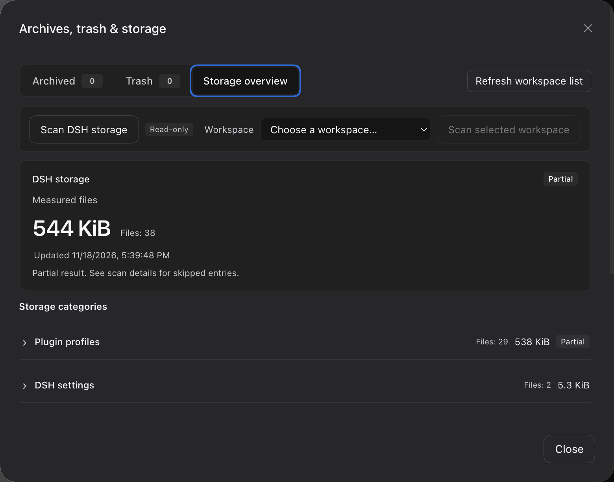

<p align="center">
  
</p>

<h1 align="center">dsh-archive-delete</h1>

<p align="center">DeepSeek Harness 的归档回收站与存储概览。</p>

<div align="center">

[安装](#安装) · [界面预览](#界面预览) · [最新发行版](https://github.com/QwQBiG/dsh-archive-delete/releases/latest) · [English](README.md)

</div>

## 安装

**v0.0.4** 支持 macOS 和 Windows 上使用 JSONL 存储的 **DSH Desktop 0.2.1-rc.3 和 0.2.1-rc.5**。打开 DSH 桌面端的 **插件 → 添加插件**，粘贴下方的预编译安装包地址。

```text
https://github.com/QwQBiG/dsh-archive-delete/releases/download/v0.0.4/qwqbig-dsh-archive-delete-0.0.4.tgz
```

已安装的用户可以在插件详情里选择 **查看并升级 → 确认升级**。如果提示重启，请完全退出 DSH 再打开。旧版没有更新按钮时，可以用上方地址升级。 [安装和排错](docs/installation.zh-CN.md)

## 能做什么

| 你想做的事 | 从哪里开始 |
| --- | --- |
| **批量清理归档会话** | 从归档会话的菜单选 **移入回收站**，也可以打开 **管理归档、回收站与存储** 批量选择。按大小排序可先找到占用较多的会话。专属子代理会随主会话一起移动。 |
| **恢复或永久清除** | 在 **回收站** 恢复会话到原工作区，或者确认后永久清除。展开 **最近永久删除** 可查看已完成的清除记录。 |
| **看看空间都占在哪** | 在 **存储概览** 扫描 DSH 或工作区，查看文件类型、大文件和一级目录。扫描只读取文件信息。 |

回收站内容会保留到你恢复或清除为止，卸载插件后也会保留。如果会话还在等待 DSH 处理，可在 **已归档** 选择 **取消等待并重新核对** 再试。 [回收站与恢复说明](docs/operations.zh-CN.md)

## 界面预览

这是当前 `main` 分支的存储概览，使用示例数据。上方安装地址对应稳定发行版。



<details>
<summary>早期截图与操作演示</summary>

以下示例采用 v0.0.2 的布局。 [观看操作演示](https://raw.githubusercontent.com/QwQBiG/dsh-archive-delete/main/assets/demo-zh.gif)

**归档会话**


**回收站**


**存储分类**


</details>

## 项目资料

[更新日志](CHANGELOG.zh-CN.md) · [参与贡献](CONTRIBUTING.zh-CN.md) · [架构](docs/architecture.zh-CN.md) · [验证记录](docs/acceptance.zh-CN.md) · [Apache-2.0](LICENSE)
